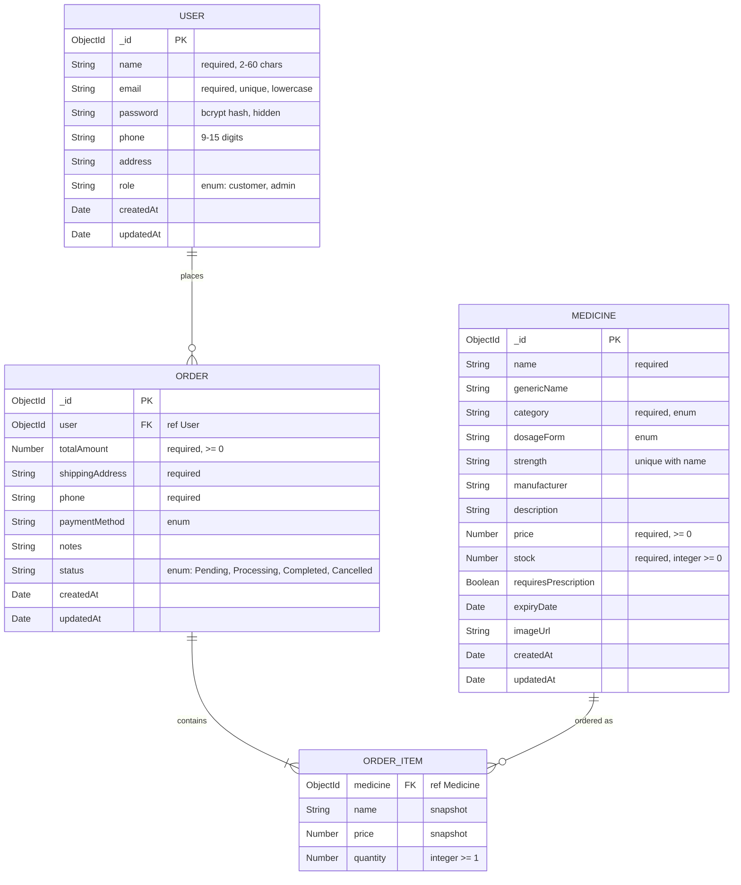

# MediCare – Online Pharmacy Ordering System

EE4207 Web Application Development – Mini Project

A full-stack **MERN** (MongoDB, Express, React, Node.js) web application. Customers can browse and search medicines, add them to a cart and place orders. An administrator manages the medicine catalogue, processes customer orders and manages user accounts.

---

## Features

### Customer
- Register and log in (passwords hashed with bcrypt, JWT authentication)
- Browse medicines in a responsive grid
- **Search** by name, generic name or manufacturer
- **Filter** by category, price range and in-stock only
- **Sort** by newest, name or price, with pagination (filters are kept in the URL)
- View medicine details (strength, dosage form, manufacturer, expiry, stock)
- Add to cart, change quantities, remove items
- Place an order (stock is checked and reserved on the server)
- View order history, filter by status and cancel pending orders
- **My Profile**: update name, email, phone and address, and change password

### Admin
- Dashboard statistics (medicines, low stock, pending orders, total orders, customers, revenue)
- **Medicines – full CRUD**
  - Create and update through a validated form
  - Table with search, category / stock filters and sortable columns
  - Delete with a confirmation dialog. Blocked while the medicine is in an open (Pending/Processing) order
- **Orders**: view all orders, search by customer, filter by status, sort by date or total, view details, and change status `Pending → Processing → Completed` or `Cancelled` (stock is returned automatically)
- **Users – full CRUD**: create customer or admin accounts, search / filter / sort users, edit details, change role, reset a password, and delete accounts
  - An admin cannot delete their own account or remove their own admin role
  - The last admin account cannot be removed
  - Users with open orders cannot be deleted. Past orders are kept when a user is deleted

### Validation and error handling
- Client-side validation in React with messages next to each field
- Server-side validation with `express-validator` and Mongoose schema rules
- Central error handler with consistent JSON errors (400 validation, 401/403 auth, 404, 409 conflict)
- Role-based access control on both the API and the React routes
- Atomic stock updates prevent overselling when two customers order the last unit

---

## Tech Stack

| Layer | Technology |
|-------|-----------|
| Frontend | React 18, React Router 6, Vite, CSS (responsive, no UI framework) |
| Backend | Node.js, Express.js (REST API) |
| Database | MongoDB with Mongoose ODM |
| Auth | JSON Web Tokens (JWT), bcryptjs |
| Validation | express-validator + Mongoose validators + client-side checks |

---

## Project Structure

```
├── server.js                  # Entry point: loads env, connects DB, starts server
├── src/                       # Backend (Express + Mongoose)
│   ├── app.js                 # Express app, API routes, serves the React build
│   ├── config/db.js           # MongoDB connection
│   ├── models/                # User, Medicine, Order schemas
│   ├── controllers/           # Business logic for each resource
│   ├── routes/                # REST API route definitions
│   ├── validators/            # express-validator rules
│   ├── middleware/            # JWT auth + roles, validation, error handler
│   └── utils/                 # Helpers and the database seed script
├── client/                    # Frontend (React + Vite)
│   ├── vite.config.js         # Dev server, proxies /api to Express
│   └── src/
│       ├── main.jsx, App.jsx  # Entry point and routes
│       ├── api/client.js      # fetch wrapper for the REST API
│       ├── context/           # Auth, Cart and Toast state (React Context)
│       ├── hooks/             # useDebounce, useMeta
│       ├── components/        # Navbar, ProtectedRoute, shared UI (Modal, Field, ...)
│       ├── pages/             # Home, MedicineDetails, Cart, MyOrders, Login, Register, Profile
│       ├── pages/admin/       # AdminMedicines, AdminOrders, AdminUsers + form modals
│       └── utils/             # Formatting and validation helpers
└── docs/screenshots/          # UI screenshots for the report
```

---

## Setup and Installation

### Prerequisites
- [Node.js](https://nodejs.org/) 18 or later
- MongoDB, either
  - [MongoDB Community Server](https://www.mongodb.com/try/download/community) installed locally, **or**
  - a free [MongoDB Atlas](https://www.mongodb.com/cloud/atlas) cluster

### Steps

```bash
# 1. Clone the repository
git clone <your-repo-url>
cd <repo-folder>

# 2. Install backend and frontend dependencies
npm run install-all

# 3. Create the environment file
cp .env.example .env        # Windows PowerShell: Copy-Item .env.example .env
#    then edit .env and set MONGO_URI and JWT_SECRET

# 4. Load sample data (admin account, demo customer, 14 medicines)
npm run seed
```

### Run in development (hot reload)

```bash
npm run dev
```
This starts Express on **http://localhost:5000** and React on **http://localhost:5173**. Open **http://localhost:5173**.

### Run in production mode

```bash
npm run build     # builds React into client/dist
npm start         # Express serves the API and the React app
```
Open **http://localhost:5000**.

### Environment variables

| Variable | Description | Example |
|----------|-------------|---------|
| `PORT` | Port for the Express server | `5000` |
| `MONGO_URI` | MongoDB connection string | `mongodb://127.0.0.1:27017/pharmacy_db` |
| `JWT_SECRET` | Secret used to sign login tokens | any long random string |
| `JWT_EXPIRES_IN` | Token lifetime | `1d` |
| `SEED_ADMIN_EMAIL`, `SEED_ADMIN_PASSWORD`, ... | Optional: change the accounts created by `npm run seed` | see `.env.example` |

### Demo accounts (created by `npm run seed`)

| Role | Email | Password |
|------|-------|----------|
| Admin | admin@pharmacy.com | Admin@123 |
| Customer | customer@pharmacy.com | Customer@123 |

> `npm run seed` deletes all existing users, medicines and orders before inserting the sample data.

---

## Database Design

Three MongoDB collections are used. Orders reference users and medicines by `ObjectId`. Each order item also stores a **snapshot** of the medicine name and price at the time of purchase, so order history stays correct even if a medicine is later edited or deleted.



`ORDER_ITEM` is an embedded sub-document array inside `ORDER` (not a separate collection).

**Indexes:** `users.email` (unique), `medicines.{name, strength}` (unique), `medicines.category`, `medicines.price`, `orders.{user, createdAt}`, `orders.status`.

---

## REST API

All responses are JSON. Protected routes need the header `Authorization: Bearer <token>`.

### Auth and profile
| Method | Endpoint | Access | Description |
|--------|----------|--------|-------------|
| POST | `/api/auth/register` | Public | Create a customer account |
| POST | `/api/auth/login` | Public | Log in, returns token and user |
| GET | `/api/auth/me` | Logged in | Current user |
| PUT | `/api/auth/me` | Logged in | Update own profile |
| PUT | `/api/auth/password` | Logged in | Change own password |

### Medicines
| Method | Endpoint | Access | Description |
|--------|----------|--------|-------------|
| GET | `/api/medicines` | Public | List with `q`, `category`, `minPrice`, `maxPrice`, `inStock`, `lowStock`, `sort`, `page`, `limit` |
| GET | `/api/medicines/meta` | Public | Categories, dosage forms, sort options |
| GET | `/api/medicines/:id` | Public | Medicine details |
| POST | `/api/medicines` | Admin | Create medicine |
| PUT | `/api/medicines/:id` | Admin | Update medicine |
| DELETE | `/api/medicines/:id` | Admin | Delete medicine (blocked if in an open order) |

### Orders
| Method | Endpoint | Access | Description |
|--------|----------|--------|-------------|
| POST | `/api/orders` | Customer | Place an order |
| GET | `/api/orders/my` | Logged in | Own order history (`status` filter) |
| PATCH | `/api/orders/:id/cancel` | Customer | Cancel own pending order |
| GET | `/api/orders/:id` | Owner / Admin | Order details |
| GET | `/api/orders` | Admin | All orders (`status`, `q`, `sort`) |
| PATCH | `/api/orders/:id/status` | Admin | Change order status |
| GET | `/api/orders/stats` | Admin | Dashboard statistics |

### Users
| Method | Endpoint | Access | Description |
|--------|----------|--------|-------------|
| GET | `/api/users` | Admin | List users with order counts (`q`, `role`, `sort`) |
| GET | `/api/users/:id` | Admin | User details |
| POST | `/api/users` | Admin | Create a customer or admin account |
| PUT | `/api/users/:id` | Admin | Update details, role or password |
| DELETE | `/api/users/:id` | Admin | Delete account (blocked for self, last admin, or open orders) |

---

## Example Workflow

1. Customer registers at `/register`.
2. Customer logs in.
3. Customer browses / searches medicines and opens **Paracetamol**.
4. Customer adds it to the cart and places the order from `/cart` (stock decreases).
5. Admin logs in, opens **Orders**, views the new order and marks it **Processing**, then **Completed**.
6. Customer sees the updated status in **My Orders**.
7. Admin opens **Users** to edit the customer's details or create another admin.

---

## Screenshots

Save screenshots in `docs/screenshots/` and they will appear below.

| Page | Screenshot |
|------|-----------|
| Home / catalogue |  |
| Medicine details |  |
| Cart & checkout |  |
| My orders |  |
| My profile |  |
| Admin – medicines |  |
| Admin – add/edit form |  |
| Admin – orders |  |
| Admin – users |  |
| Mobile view |  |

---

## Author

- Name: _your name_
- Index number: _your index number_
